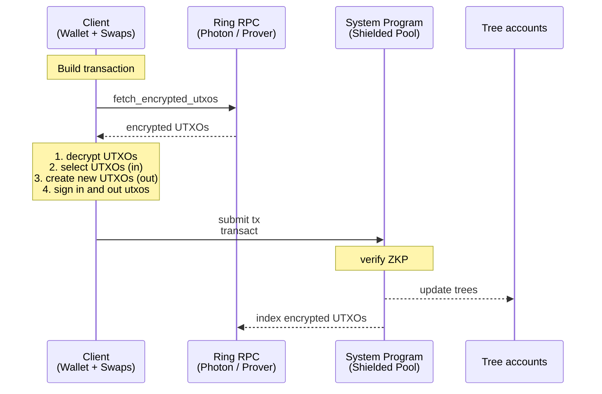
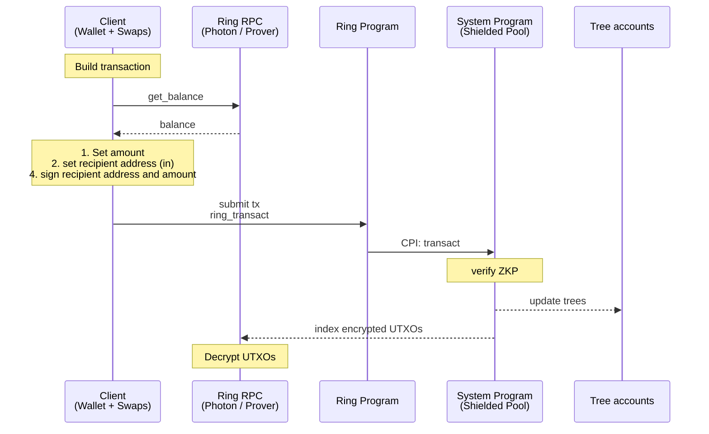
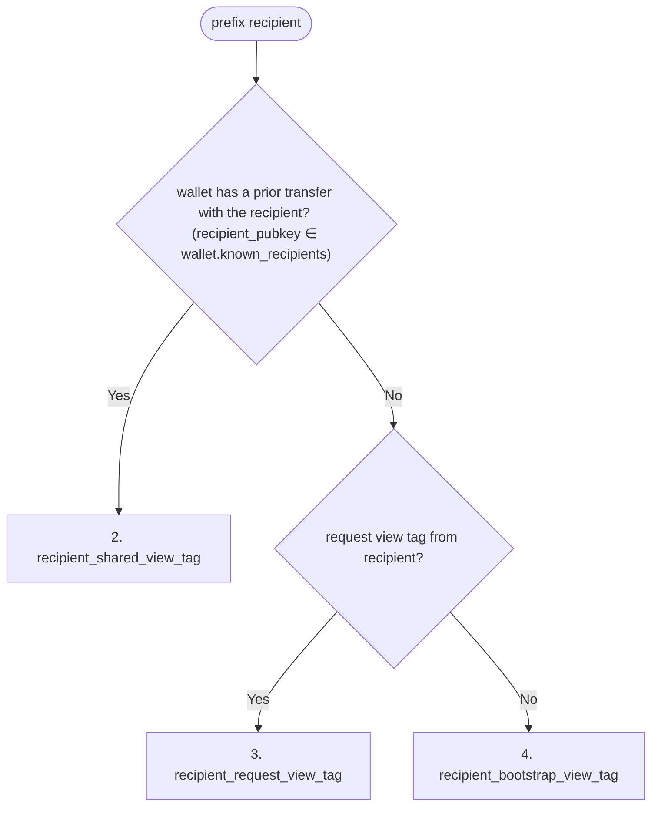
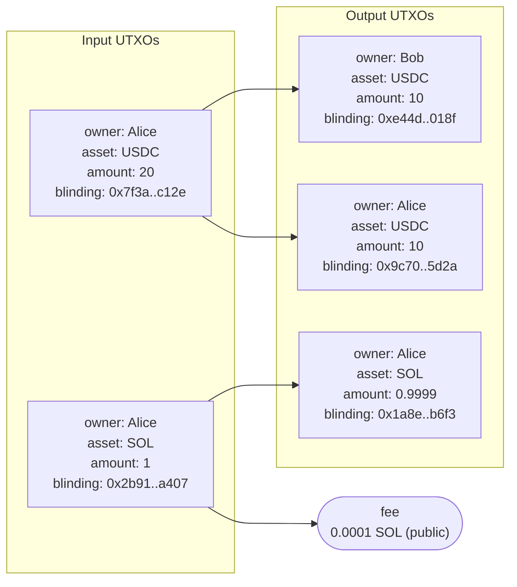

# Spec

## Table of Contents

- [Abstract](#abstract)
- [Architecture](#architecture)
  - [Operations](#operations)
    - [User](#user)
    - [Protocol](#protocol)
    - [Ring Creator](#ring-creator)
    - [Merge Service](#merge-service)
  - [Concurrency & Balance Fragmentation](#concurrency--balance-fragmentation)
  - [Default Ring](#default-ring)
  - [Policy Rings](#policy-rings)
- [Glossary](#glossary)
- [Shielded Address](#shielded-address)
- [Shielded Keypair](#shielded-keypair)
  - [Signing Key](#signing-key)
  - [Nullifier Key](#nullifier-key)
  - [ViewingKey](#viewingkey)
    - [Derived secrets](#derived-secrets)
    - [Transaction Viewing Key](#transaction-viewing-key)
    - [View Tags](#view-tags)
      - [Sender View Tag](#sender-view-tag)
      - [Recipient view tag](#recipient-view-tag)
      - [Merge view tag](#merge-view-tag)
      - [View Tag Selection](#view-tag-selection)
    - [Methods](#methods)
  - [Derivation seed](#derivation-seed)
  - [Solana wallet](#solana-wallet)
  - [HSM](#hsm)
  - [PDA](#pda)
- [UTXO](#utxo)
  - [UTXO Hash](#utxo-hash)
  - [Nullifier](#nullifier)
  - [Blinding Seed](#blinding-seed)
  - [Output Blinding](#output-blinding)
- [Output UTXO Serialization](#output-utxo-serialization)
  - [UTXO Data](#utxo-data)
  - [Transfer](#transfer-2)
    - [Plaintext Layout](#plaintext-layout)
    - [Instruction Data Layout](#instruction-data-layout)
  - [Plaintext Transfer](#plaintext-transfer)
  - [UTXO Split](#utxo-split)
    - [Plaintext Layout](#plaintext-layout-1)
    - [Instruction Data Layout](#instruction-data-layout-1)
  - [Merge](#merge)
    - [PoseidonCtrV1](#poseidonctrv1)
    - [Ring merge output encryption](#ring-merge-output-encryption)
- [SPP Proof - Solana Privacy ZK Proof](#spp-proof---solana-privacy-zk-proof)
- [Merge Proof - Merge ZK Proof](#merge-proof---merge-zk-proof)
- [SPP - Solana Privacy Program](#spp---solana-privacy-program)
  - [Accounts](#accounts)
    - [Authority Governance](#authority-governance)
    - [Ring Accounts](#ring-accounts)
  - [Instructions](#instructions)
    - [transact](#transact)
    - [deposit](#deposit)
    - [ring_deposit](#ring_deposit)
    - [merge_transact](#merge_transact)
    - [merge_ring](#merge_ring)
- [Ring Program Interface](#ring-program-interface)
- [ZK Program Interface](#zk-program-interface)
- [RPC](#rpc)
  - [Indexer](#indexer)
    - [getEncryptedUtxosByTags](#getencryptedutxosbytags)
    - [getShieldedTransactionsByTags](#getshieldedtransactionsbytags)
    - [subscribeToShieldedTransactionsByTags](#subscribetoshieldedtransactionsbytags)
    - [getMerkleProofs](#getmerkleproofs)
    - [getNonInclusionProofs](#getnoninclusionproofs)
    - [getUserRecords](#getuserrecords)
  - [Prover](#prover)
  - [Relayer](#relayer)
  - [Ring RPC](#ring-rpc)
    - [get_decrypted_utxos_by_owner](#get_decrypted_utxos_by_owner)
    - [get_decrypted_transactions_by_owner](#get_decrypted_transactions_by_owner)
    - [subscribe_to_decrypted_transactions_by_owner](#subscribe_to_decrypted_transactions_by_owner)
  - [Merge Service](#merge-service-1)
  - [Registry](#registry)
    - [Record](#record)
    - [Operations](#operations-1)
      - [`get_record`](#get_record)
      - [`register`](#register)
      - [`set_merge_encryption`](#set_merge_encryption)
- [User Flows](#user-flows)
  - [First Time Sync Wallet](#first-time-sync-wallet)
  - [Merge Flow](#merge-flow)
  - [Transfer User Flows](#transfer-user-flows)
    - [Privacy Guarantee Matrix](#privacy-guarantee-matrix)

## Abstract

The solana privacy protocol (TSPP) enables programmable, UTXO-based confidential transfers that execute directly on Solana, and supports private DeFi and institutional compliance. UTXO balances are backed by SPL and Token-2022 tokens, viewing keys provide selective disclosure, and owner tagging enables wallet sync at Solana speed. Policy rings add anonymity.

Confidential transfers are performed by a minimal Solana Privacy Program (SPP) that enforces UTXO state transitions with a zero knowledge proof (ZKP). To enable private DeFi, third-party programs run custom private logic in a separate ZKP over user-owned UTXOs that hold arbitrary `utxo_data`, authorized by the owner's signature. For tailored compliance, institutions can implement rings with custom ring programs, for example with configurable auditors, authorities, freeze authority, co-signer, permanent delegate, and anonymity.

For wallet sync at Solana RPC speed, the owner pubkey prefixes every encrypted UTXO so wallets and indexers locate relevant outputs without trial decryption.

For compatibility with Solana addresses, a registry maps Solana addresses to shielded addresses, so a sender holding only a recipient's Solana address can pay them privately.

An optional merge service consolidates fragmented balances without per-merge wallet signatures once the owner enables merging on their registry record.

The document specifies the key derivation, UTXO layout, SPP accounts and instructions, the ring program interface, the ZK program interface, the ZK circuits, the indexer / prover / relayer / ring RPC / merge service / registry interfaces, and user flows.

# Architecture


Source: [`diagrams/architecture.dot`](diagrams/architecture.dot). Regenerate with `just render-diagrams`.

1. Users — own wallets, build encrypted transactions, and authorize spends with Ed25519 transaction signatures.
2. Photon Indexer — indexes trees + encrypted UTXOs; default-ring users fetch ciphertexts here.
3. Ring RPC (with auditor) — RPC with auditor keys; decrypts and serves UTXOs to policy-ring users.
4. Prover — generates Groth16 proofs. Users can generate client side proofs as well.
5. Relayer (optional) — fee-payer that submits a transaction on a user's behalf; by default users invoke the programs directly. Targets SPP (default ring), the ZK Swap program, or a Ring program (policy ring).
6. Forester — processes the nullifier queue into the nullifier tree and closes reclaimable nullifier PDAs.
7. SPP (Solana Privacy Program) — verifies proofs, updates trees, moves SPL to and from the vaults.
8. ZK Swap Program — enforces swap logic in a zk proof and settles the swap with a shielded transfer by CPI into a Ring program or directly into SPP.
9. Ring Programs (1..N) — config programs; verify policy proofs and CPI into SPP.
10. SPL interface — per-mint SPL / Token-22 holding all shielded tokens.
11. Tree accounts — co-located UTXO tree, nullifier tree, and nullifier queue.

Per-flow sequence diagrams are in the [User Flows](#user-flows) section below.


## Operations

### User

Operations 1-4 run against the default ring via [`transact`](#transact) (or [`deposit`](#deposit)), or against a policy ring via the ring program's CPI into `ring_transact` (or [`ring_deposit`](#ring_deposit) for proofless deposits).

| # | Name | Description | Privacy |
| --- | --- | --- | --- |
| 1 | deposit | Deposit SPL tokens into the shielded pool; existing UTXOs can be merged in the same transaction. | sender + amount visible; recipient visible |
| 2 | deposit | Public deposit without a proof. Allows depositing dynamic amounts, for example for the flow withdraw, swap, deposit. | sender + amount visible; recipient `owner` visible |
| 3 | withdraw | Withdraw SPL tokens from the shielded pool to a public account. | sender visible (or hidden via an optional relayer); recipient + amount visible |
| 4 | shielded transfer | Transfer value between shielded balances. | confidential: amount hidden; sender + recipient visible (anonymous in a policy ring) |

### Protocol

| # | Name | Description |
| --- | --- | --- |
| 1 | create_spl_interface | Initialize SPL/Token-22 pool escrow per token mint |
| 2 | create_tree | Create and initialize a new Tree PDA (nullifier tree + queue and UTXO tree, co-located) |
| 3 | create_protocol_config | Initialize protocol config (role authorities, permissionless flags) |
| 4 | update_protocol_config | Rotate the protocol config authority and the role authorities |
| 5 | pause_tree | Freeze writes to a Tree account |
| 6 | set_tree_fees | Set a tree's fee schedule (fee per tree, append and close reimbursements) |
| 7 | claim_tree_lamports | Claim a tree's lamports above its rent, reimbursement reserve, and nullifier PDA working capital |
| 8 | set_ring_activation | Activate or deactivate a ring, and set its `ring_authority_transact_is_enabled` |

### Ring Creator

Operations performed by the owner of a policy ring's config.

| # | Name | Description |
| --- | --- | --- |
| 1 | create_ring_config | Create the ring config PDA and set its owner; activation follows [Ring Accounts](#ring-accounts) |
| 2 | update_ring_config | Set `paused`. A paused ring cannot authorize any ring operation; the owner can still update or rotate the config |
| 3 | update_ring_config_owner | Transfer ring config ownership |
| 4 | ring_authority_transact | Prove correctness of a state transition by a ring authority (freeze, thaw, permanent-delegate transfer) |

### Merge Service

Operations performed by a merge service for a user who has selected a merge encryption scheme (`merge_encryption != Disabled`) on their [registry record](#registry). See [Merge Service](#merge-service-1) for the operator's responsibilities.

| # | Name | Description |
| --- | --- | --- |
| 1 | merge_transact | Consolidate N input UTXOs of the same owner and asset into one default-ring output UTXO |
| 2 | merge_ring | Policy-ring analog of `merge_transact`; called via CPI from a ring program. Inputs and output share `ring_program_id` |


## Concurrency & Balance Fragmentation

UTXOs are inherently concurrent. Every transaction to a user will fragment the users balance since the transaction amount is a new UTXO.

1. The balance of a keypair can be used concurrently when it is split up between a number of utxos.
2. To keep the balance spendable in one transaction we split it in up to X utxos.
3. Optionally, fragmented balances can be reconsolidated without user interaction by a trust minimized [merge service](#merge_transact) once the user has enabled merging on their registry record.


## Default Ring

The default ring is confidential and has no policy: amounts and assets are private, owners are public. Each output is tagged by its Ed25519 owner pubkey and bound to the output UTXO in the SPP proof, so wallets sync by querying the indexer for their own pubkey.
Users invoke the SPP directly.
An optional merge service can be used to improve UX.

### Transfer



## Policy Rings

**Properties:**
1. Fully programmable: the ring creator deploys a ring program that implements custom logic enforcing encryption to auditors, authorities, freeze authority, co-signer, and permanent delegate.
2. Enter Ring: a ring is entered by a deposit from an SPL token account, the standard shielded pool, or another ring via a shielded transfer.
3. Exit Ring: a ring is exited by a withdraw to an SPL token account, the standard shielded pool, or another ring via a shielded transfer.
4. Transfers: users invoke the ring program, which CPIs into the SPP program.

**Policy sources:** the reference ring program compiles its rule table into the binary and pins `RuleTable.hash` over a per-list source map at `create_policy`. Each list the table references names the namespace serving it, the ring's own namespace PDA or a curator ring's. One curated list (an OFAC blocklist) serves many rings from one write. The map enters the policy hash as eight positional `(list_id, owner_hash)` slots and the transfer circuit resolves every answer's owner from it. `set_policy_source` lets the ring authority re-point one list only while the stored hash is reproducible from the deployed table, a rebuilt table stays fail closed. Every source claims its entry addresses in the ring's address tree, and the entries live in any tree. The encoding is pinned by `zolana-custom-rings/program-libs/policy` and the cross-language vectors in `zolana-custom-rings/sdk-libs/sdk/tests/go_policy_vectors.rs`.


### Transfer




# Glossary

Type aliases used in the `struct` definitions throughout this spec. Each is defined once here and referenced by name elsewhere.

| Type | Definition | Description |
| --- | --- | --- |
| `PublicKey` | `[u8; 34]` | 1-byte scheme prefix + 33-byte body. Prefix `0x00` is reserved and every decoder rejects it; `0x01`: Ed25519, 32-byte key then one zero byte; `0x02`: PDA, 32-byte Solana address then one zero byte (off-curve, cannot sign). The protocol's scheme-tagged key, used wherever the scheme varies — UTXO owners (`signing_pk` / `owner_pubkey`). |
| `X25519Pubkey` | `[u8; 33]` | X25519 public key, `0x04 \|\| u` with `u` the little-endian Montgomery u-coordinate. Only a canonical `u < 2^255 - 19` decodes. No scheme prefix beyond the tag. Used where the key is X25519 by construction, the viewing and ECDH keys (`tx_viewing_pk`, registry `viewing_pk`, ring auditor keys, ephemeral envelope keys). |
| `X25519Keypair` | — | An X25519 `(secret, public)` keypair. The secret is stored clamped: `clamp` is RFC 7748 `decodeScalar25519`, so each key has one secret byte string. Its public half is an `X25519Pubkey`. |
| `Signature` | `[u8; 64]` | An Ed25519 signature. A Solana transaction signature, or a Ring RPC request signature under the signer's key. |
| `SPPProof` | `[u8; 192]` | Vanilla Groth16 proof `a(32) || b(128) || c(32)`: `a` and `c` are compressed G1 points, `b` is the raw big-endian G2 point. |
| `TransactProof` | struct | A 192-byte vanilla Groth16 proof (`a`, `b`, `c`): `a` and `c` compressed G1 (32 bytes each), `b` the raw big-endian G2 point (128 bytes). |
| `CircuitId` | enum | Selects the circuit family and fixed shape: `ConfidentialSigner`, `ConfidentialRingEddsa`, `AnonymousRingEddsa`, `RingAuthority`, or `ConfidentialEddsa`, each carrying `(n_inputs, n_outputs, n_public_asset_slots)` followed by any family payload (`AnonymousRingEddsa`: `Bsb22Commitment` and an optional owner tag; `ConfidentialEddsa`: `EddsaProofData { bsb22_commitment: Bsb22Commitment, owner_pk: [u8; 32] }`; see [Circuit Combinations](#circuit-variants)). Owner-signed families have `*Cached` twins that add `CacheAccess { read_bitmap: u64, write_slots: [CacheWrite; MAX_CACHE_WRITES] }` (40 bytes, `MAX_CACHE_WRITES = 16`; validated in [`transact`](#transact) check 14) and use the family's key. Unknown values are rejected at deserialization. |

Raw fixed-size byte arrays keep their literal types where no alias adds clarity:

- `[u8; 32]` — a Poseidon or SHA-256 digest, a BN254 field element (including blindings), an owner pubkey, or a view tag.

Hashing conventions:

- `Sha256BE` — SHA-256 over the byte preimage, then `digest[0] = 0`, interpreted as a BN254 field element. Zeroing the most-significant byte holds the result below the BN254 field modulus.
- `hash_bytes_N` — a fixed-length byte commitment. Split the `N` bytes into consecutive 31-byte big-endian chunks, right-align each chunk in a 32-byte BN254 field representation, set `acc = chunk_0`, then fold each remaining chunk as `acc = Poseidon(acc, chunk_i)`. `hash_bytes_0([]) = 0`; a value of at most 31 bytes is its packed field value and invokes no Poseidon permutation. The length is fixed by the calling protocol type and is not encoded or domain-separated. A generic variable-length byte-hash API is forbidden.

# Shielded Address

A shielded address consists of the signing public key, signs to spend UTXOs, the nullifier public key, ties the nullifier to a spent UTXO, and the viewing public key, encrypts the UTXO.
In compressed form the signing and nullifier public keys are compressed in an owner poseidon hash.

`ShieldedAddress = (signing_pk, nullifier_pk, viewing_pk)`

`CompressedShieldedAddress = (owner_hash, viewing_pk)`

## Fixed-byte proof-input encoding

Raw fixed-size values use `hash_bytes_N` everywhere they enter a field-level
commitment. Structured hashes over values that are already field elements keep
their stated Poseidon preimages.

```
Solana owner (Ed25519 pubkey or PDA address, 32 B):
  owner_proof_input_hash(pk) := hash_bytes_33(0x53 || pk)      // 'S'

X25519 viewing key (33 B, 0x04 || u):
  viewing_proof_input_hash(pk) := hash_bytes_33(pk)

Ring program id (32 B, untagged; `0` when absent):
  pk_field(program_id) := hash_bytes_32(program_id)
```

Owner identities carry the tag `0x53`. It differs from the X25519 key tag
`0x04`, so an owner identity cannot equal a viewing-key commitment. The
`AnonymousRingEddsa` proof computes the hidden owner's Solana identity and
asserts it differs from every signer identity; SPP hashes Solana identities.
The `ConfidentialEddsa` proof verifies its owner's Ed25519 signature
in-circuit, and SPP publishes `owner_proof_input_hash(owner_pk)` of that key
as its own public input.

## Owner Hash

```
owner_hash := Poseidon(owner_proof_input_hash(signing_pk), nullifier_pk)
```

SPP derives the Solana owner proof input from the verified signer account — an
Ed25519 signer or a PDA signing via `invoke_signed`. The circuit relies on the
SVM's signature verification, so the two are equivalent in the proof. The
`AnonymousRingEddsa` rail instead proves one shared Ed25519 signature and
derives the owner proof input from the hidden owner's Ed25519 key in-circuit.
The `ConfidentialEddsa` rail proves one Ed25519 signature of a published
owner; its owner proof input is the same `owner_proof_input_hash` the key has
as a Solana signer, so a UTXO of an Ed25519 owner spends on either rail with
one `owner_hash`.

# Shielded Keypair

The client-side triple behind a [Shielded Address](#shielded-address): a
[Signing Key](#signing-key), a [Nullifier Key](#nullifier-key), and a
[ViewingKey](#viewingkey).

**Curves** (the `PublicKey` scheme prefix, [Glossary](#glossary)):

- `Ed25519` — Solana signer, authorized by SPP's signer-account check, or by one Ed25519 signature proven in-circuit: the shared hidden owner on `AnonymousRingEddsa`, the published owner on `ConfidentialEddsa`.
- Prefix `0x00` is reserved, and every decoder rejects it.
- `Pda` — off the Ed25519 curve and cannot sign; the owning program authorizes via `invoke_signed`.

**Interface**:

- `signing_pubkey` — the [Signing Key](#signing-key) public key (`PublicKey`).
- `viewing_pubkey` — [ViewingKey](#viewingkey) public key (`X25519Pubkey`).
- `curve` — the signing scheme identifier: the `PublicKey` scheme prefix ([Glossary](#glossary)).
- `sign_message(msg)` — message signature in the scheme's native form ([Signing Key](#signing-key) methods).
- `nullifier_key` — the host-side [Nullifier Key](#nullifier-key), used to build spendable inputs.
- `nullifier(utxo)` — the UTXO's [nullifier](#nullifier).
- `nullifier_pk` — the published half of the nullifier role ([Nullifier Key](#nullifier-key)).
- `owner_hash` — the [Owner Hash](#owner-hash) of the signing and nullifier public keys.
- `shielded_address` — the three public keys as a [Shielded Address](#shielded-address).
- `compressed_address` — its compressed form: `owner_hash` and `viewing_pubkey`.

## Signing Key

`(signing_sk, signing_pk)` — the spend-authorizing keypair.

**Methods:**

- `pubkey() -> PublicKey` — the scheme-tagged public key ([Glossary](#glossary)).
- `sign_message(msg) -> Result<Signature>` — Ed25519 over the raw bytes (RFC 8032, delegated to the host Solana wallet). PDA: error. On the `AnonymousRingEddsa` and `ConfidentialEddsa` rails the owner signs the digest `SHA-256(private_tx_hash || external_data_hash)` with this method, and the proof verifies the signature.

## Nullifier Key

Symmetric 31-byte key to derive nullifiers. The `nullifier_secret` is
wallet-side material: it is a private proof input on every spend path, so it
cannot be hardware-resident. It is required to spend but does not authorize a
spend: authorization is the owner signature, checked by the proof
(`AnonymousRingEddsa`, `ConfidentialEddsa`) or by SPP's signer-account check
(Ed25519, PDA).

`nullifier_pk := Poseidon(nullifier_secret)`

**Methods:**

- `nullifier_pk() -> [u8; 32]` — returns `nullifier_pk` (defined above).
- `nullifier(utxo) -> [u8; 32]` — the UTXO's [nullifier](#nullifier).

## ViewingKey

`(viewing_sk, viewing_pk)` is an [`X25519Keypair`](#glossary), used
for HPKE-style encryption and to derive view-tag secrets. Viewing keys can
rotate. Each scenario defines how `viewing_sk` is produced.

- `viewing_pk := 0x04 || X25519(viewing_sk, 9)`, the `X25519Pubkey` ([Glossary](#glossary)). A decoder rejects a non-canonical `u` (`u >= 2^255 - 19`) and any tag other than `0x04`.
- `ECDH(sk, pk)` is the 32-byte RFC 7748 output `X25519(sk, pk.u)`. An all-zero result (a low-order peer) is rejected before any key derives from it.

### Derived secrets

Secrets derive from `view_root`.

- `view_root := HKDF-Extract(salt="TSPP/view_root/x25519/v1", IKM=viewing_sk)`
- `sender_view_tag_secret    := HKDF-Expand(view_root, "TSPP/sender_view_tag",    L=32)`
- `recipient_view_tag_secret := HKDF-Expand(view_root, "TSPP/recipient_view_tag", L=32)`
- `tx_viewing_secret         := HKDF-Expand(view_root, "TSPP/tx_viewing/x25519/v1", L=32)` — seeds the transaction viewing keys.

### Transaction Viewing Key

The transaction viewing key is a single use keypair (ephemeral key) that is deterministically derived for every private transaction.
Every ciphertext in a transaction is encrypted with HPKE between the transaction viewing key and the ciphertext owner's viewing key.
This way the transaction viewing key can decrypt both the sender's change and recipient UTXOs of the transaction.

**Properties**

- **Scope**: one transaction.
- **Read-only**: viewing keys grant decryption only.
- **Derivable on demand**:
  ```
  first_nullifier := nullifier_key.nullifier(inputs[0])              // see [Nullifier](#nullifier)
  tx_viewing_sk := clamp(HKDF-SHA256(salt=first_nullifier, IKM=tx_viewing_secret, info="TSPP/tx_viewing/x25519/v1", L=32))
  tx_viewing_pk := 0x04 || X25519(tx_viewing_sk, 9)
  ```
  `tx_viewing_secret` is defined in [ViewingKey](#viewingkey), `clamp` in [`X25519Keypair`](#glossary). Binding the HKDF salt to `first_nullifier` makes the keypair unique per Solana transaction (nullifier tree uniqueness implies `tx_viewing_pk` uniqueness).

### View Tags

The view-tag types in this section (`sender_view_tag`, `recipient_shared_view_tag`, `recipient_request_view_tag`, `recipient_bootstrap_view_tag`) apply to **anonymous policy rings only**. In the confidential [default ring](#default-ring) every output — sender change, recipients, and the [`merge_transact`](#merge_transact) output — is tagged by its Ed25519 owner pubkey, so a wallet syncs by querying the indexer for its own owner pubkey.

Policy rings hide the recipient, so a wallet cannot find its outputs by owner pubkey as in the [default ring](#default-ring). Instead a view tag, a 32-byte value attached to a ciphertext, lets wallets sync by querying the indexer for exact view-tag matches and decrypt only their own transactions. Derivation splits into two cases — tags the sender derives for themselves to discover their own change UTXOs, and tags the sender derives for the recipient to discover incoming transfers.

A recipients wallet cannot pre-derive shared tags for every possible sender. Therefore the wallet needs to know which senders to derive view tags for. The first transfer between a new sender-recipient pair uses a tag the recipient can find without prior knowledge of the sender: either `recipient_request_view_tag` (recipient minted, shared out-of-band) or `recipient_bootstrap_view_tag = recipient.viewing_pk` (no coordination required). This first transfer establishes the pair: on decryption the recipient reads `sender_pubkey` from the ciphertext and derives the shared ECDH key, and subsequent transfers from this sender use a shared tag (`recipient_shared_view_tag`) to find transaction. `sender → recipient` and `recipient → sender` produce disjoint tags.

**Uniqueness.** View tags should not be reused. The indexer must handle the case that these may be used multiple times erroneously and return all ciphertexts matching a single tag value.

**Encoding.**  all view tags are constant length 32 bytes. Shorter view tags are prefixed with 0s.

**Proof.** No proof derives a view tag or opens an anonymous body. A wrong tag or a body sealed to the wrong key costs the recipient the note, as a payment to a wrong address does, and gains the sender nothing because its inputs are already spent. A policy ring's auditor reads every output from its proven disclosure.

#### Sender View Tag

1. **`sender_view_tag`**
  - Derived by: the sender, to index her change utxos.
  - Tx sent by: the sender
  - Indexed by: the sender
  - Derivation: `HKDF-SHA256(salt=∅, IKM=sender_view_tag_secret, info="TSPP/sender_view_tag/" || u64_be(tx_count), L=31)`.

#### Recipient view tag

2. **`recipient_shared_view_tag`**
    - Derived by: the sender and recipient independently. Sender via `get_send_shared_view_tag` to send the tx, the recipient via `get_recipient_shared_view_tag` to index the tx.
    - Tx sent by: the sender.
    - Indexed by: the recipient.
    - Derivation: two chained HKDFs over the ECDH shared secret.

      ```
      S      := sender.viewing_pk
      R      := recipient.viewing_pk
      shared := ECDH(sender.viewing_sk, R)        // sender
              = ECDH(recipient.viewing_sk, S)     // recipient
      domain := HKDF-SHA256(salt = ∅, IKM = shared,
                           info = "TSPP/pair-domain/" || R, L = 32)
      return    HKDF-SHA256(salt = ∅, IKM = domain,
                           info = "TSPP/pair-hint/"   || u64_be(i), L = 31)
      ```

      The sender reads `R` from the recipient's address, the recipient reads `S` from the `sender_pubkey` of the first transfer between the pair.
3. **`recipient_request_view_tag`**
    - Derived by: the recipient. The recipient shares the tag with the sender out-of-band as a `PaymentRequest`.
    - Tx sent by: the sender.
    - Indexed by: the recipient. Once the recipient decrypts this transfer, subsequent transfers from the same sender can be indexed by `recipient_shared_view_tag`.
    - Derivation: `HKDF-SHA256(salt=∅, IKM=recipient_view_tag_secret, info="TSPP/recipient_request_view_tag/" || u64_be(request_count), L=31)`.
4. **`recipient_bootstrap_view_tag`**
    - Derived by: anyone — the 32-byte `u` coordinate of `recipient.viewing_pk` (the 33-byte key without its `0x04` tag).
    - Tx sent by: the sender.
    - Indexed by: the recipient. Once the recipient decrypts this transfer, subsequent transfers from the same sender can be indexed by `recipient_shared_view_tag`.
    - [Plaintext Transfer](#plaintext-transfer): sender bundles and recipient slots are indexed by the 32-byte owner tag in place of `viewing_pk`. The slot contains no `sender_pubkey`, so `known_senders` / `known_recipients` are not updated and the next encrypted transfer between the pair is again a first transfer.


#### Merge output indexing (removed merge view tag)

The single-use `merge_view_tag` stream — `merge_view_tag_secret`, a per-user `merge_count`, the HKDF tag derivation, and SPP's nullifier-tree insertion of the tag — was removed. `merge_transact` tags the merged output with the owner signing pubkey like every confidential default-ring output; [`merge_ring`](#merge_ring) indexes the output by the **first input's published nullifier**; neither instruction takes a supplied tag. The output blinding, the padding-slot nullifiers, and the key of the [merge output ciphertext](#merge) are derived from the owner's nullifier secret and that first nullifier (`merge_output_blinding` / `merge_dummy_nullifier` / `merge_output_key`, domain-separated Poseidon — see [Methods](#methods)), and replay protection comes from the proof-bound input nullifiers themselves.

#### View Tag Selection

In the [default ring](#default-ring) every output is tagged by its recipient owner pubkey, so the selection below applies only to anonymous policy rings. `merge_transact` outputs are tagged by the owner signing pubkey like every other default-ring output; `merge_ring` outputs are indexed by the first input's published nullifier, not by a view tag. Wallets select recipient tags as follows:



### Methods

1. `decrypt(ciphertext, tx_viewing_pk) -> Result<Plaintext>` — AES-CTR decryption with key `KDF(ECDH(viewing_sk, tx_viewing_pk))`.
2. `get_sender_view_tag(tx_count)` — policy-ring anonymous transfers only; tags the sender's own change UTXOs. The default ring tags change by the sender's owner pubkey.
3. `get_recipient_request_view_tag(request_count)` — used by the recipient to create a view tag for a `PaymentRequest` shared with the sender out-of-band.
4. `get_send_shared_view_tag(recipient_pubkey, i)` — sender-side `recipient_shared_view_tag`; used for transfers to a recipient the sender has already paired with.
5. `get_recipient_shared_view_tag(sender_pubkey, i)` — recipient-side `recipient_shared_view_tag`; used during sync to scan transfers from each known sender.
6. `merge_output_blinding(first_nullifier)` / `merge_dummy_nullifier(first_nullifier, slot_index)` / `merge_output_key(first_nullifier)` — deterministic merge derivations from the owner's nullifier secret (domain-separated Poseidon; the key is defined under [Merge](#merge)); used by the merge prover when building [`merge_transact`](#merge_transact) / [`merge_ring`](#merge_ring) and by the owner during sync to decrypt merged outputs. Replaces the removed `get_merge_view_tag(merge_count)`.
7. `get_transaction_viewing_key(first_nullifier: [u8; 32]) -> X25519Keypair` — the per-transaction [X25519 keypair](#transaction-viewing-key) for ECDH encryption to recipients.

## Derivation seed

The root secret both role keys expand from in the [Solana wallet](#solana-wallet)
scenario. Obtaining it consumes only a deterministic signature.

Role expansion:

- `prk := HKDF-Extract(salt=∅, IKM=derivation_seed)`
- `nullifier_secret := HKDF-Expand(prk, nf_info, L=31)`
- `viewing_sk := clamp(HKDF-Expand(prk, view_info, L=32))` — an X25519 scalar ([`X25519Keypair`](#glossary))

The [Solana wallet](#solana-wallet) scenario defines `derivation_seed`, `nf_info`, and `view_info`.

**Derivation-input guard.** Signing rejects any message whose payload (bare or
off-chain encoded) starts with `"TSPP/derive/"`. The viewing key's X25519 ECDH
rejects a low-order peer ([ViewingKey](#viewingkey)).

## Solana wallet

Sign: the wallet's Ed25519 key, checked by SPP as the signer account.

- `derivation_seed := Ed25519_sign(signing_sk, derivation_message)` — deterministic (RFC 8032), so any wallet that signs off-chain messages reconstructs the keypair and the Ed25519 secret never leaves the wallet. The 64-byte seed is itself secret material: whoever holds it derives both role keys.
- `derivation_message` — the Solana off-chain message v0 encoding of the payload `"TSPP/derive/v1"`: `"\xffsolana offchain" || version=0 || application_domain || format=0 || signer_count=1 || signing_pk || u16_le(payload_len) || payload`, with `application_domain := SHA-256("TSPP/derive/v1")`.
- `nf_info = "TSPP/nf_key/ed25519/v1"`, `view_info = "TSPP/view_key/ed25519/x25519/v1"`.

## HSM

Sign: on the device. Device signing keys cannot run key agreement, so the
[derivation seed](#derivation-seed) is unavailable: the nullifier and viewing
roles root in separate device keys (three-key custody) and are supplied at
construction. The `nullifier_secret` stays host-side
([Nullifier Key](#nullifier-key)).

## PDA

No signing key: the owning program authorizes with `invoke_signed`. Both role
keys expand from one viewing-key ECDH shared secret, with the PDA address in
each info tag so a holder does not reuse one identity across PDAs.

- `shared := ECDH(holder_viewing_sk, counterparty_viewing_pk)` — either participant derives the identity from its own viewing key and the counterparty's viewing pubkey. A sole holder uses its own `viewing_sk` as `shared`, which no ECDH query can reproduce.
- `prk := HKDF-Extract(salt="TSPP/pda_root/x25519/v1", IKM=shared)` — the salt separates PDA roles from the [view root](#derived-secrets) and from every shared view tag.
- `nullifier_secret := HKDF-Expand(prk, "TSPP/pda_nf/v1" || pda, L=31)`
- `viewing_sk := clamp(HKDF-Expand(prk, "TSPP/pda_view/v1" || pda, L=32))` — an X25519 scalar ([`X25519Keypair`](#glossary))

# UTXO

A UTXO (unspent transaction output) represents an amount of an asset in the shielded pool that its owner can spend.
UTXO hashes are appended to the UTXO Merkle tree at creation and nullifiers are inserted into the Nullifier tree when a UTXO is spent to prevent double spending. A nullifier can only be inserted once into the nullifier tree.

Example: Alice transfers 10 USDC to Bob. Alice's starting balance is one 20 USDC UTXO and one 1 SOL UTXO. Fee is 0.0001 SOL.



```rust
struct Utxo {
    /// `UtxoDomain = 3`; padding and address slots use the domains in
    /// [Input slots](#input-slots).
    domain: u16,
    /// The recipient's `owner_hash` from their
    /// [Shielded Address](#shielded-address). Senders write this 32-byte value
    /// directly.
    owner: [u8; 32],
    /// Asset mint. SOL is Address::default().
    asset: Address,
    /// Amount in the smallest unit of `asset`.
    amount: u64,
    /// Field element ensuring distinct UTXO hashes for equal
    /// `(owner, asset, amount)` triples. `deposit` derives it from the leaf
    /// index (see [Blinding](#blinding-derivation)); a `transact` output takes
    /// the value in [Output Blinding](#output-blinding).
    blinding: [u8; 32],
    /// Arbitrary data committed via `data_hash`; the application circuit/SDK
    /// interprets it.
    utxo_data: Option<Vec<u8>>,
    /// Arbitrary ring data.
    ring_data: Option<Vec<u8>>,
    /// The ring program that authorizes spends of this UTXO.
    ring_program_id: Option<Address>,
}
```

## UTXO Hash

```
utxo_hash = Poseidon(domain, tree_id, asset, amount,
                     data_hash, ring_hash, owner_utxo_hash)

ring_hash       = Poseidon(ring_data_hash, pk_field(ring_program_id))
owner_utxo_hash = Poseidon(owner, blinding)
```

The SPP proof commits to `utxo_hash` for every input and output. `tree_id` is the raw `u16` id of the tree account that holds the UTXO: the tree an input is spent from, `output_tree` for an output. Equal UTXOs in different trees therefore have distinct hashes, nullifiers, and addresses. `owner` is the `owner_hash` from [Shielded Address](#shielded-address). `asset` is `hash_bytes_32(mint)`, with SOL as `hash_bytes_32(Address::default())`; `ring_program_id` uses `pk_field` (see [Shielded Address](#shielded-address)). An absent `ring_program_id` is `0` (not `pk_field(0)`), so a UTXO without one keeps `ring_hash` over a `0` program field. `data_hash` enters `utxo_hash` directly and is `0` when absent.

`owner` is a user `owner_hash`; there is no program ownership. A UTXO may hold `utxo_data`: `data_hash` is committed into `utxo_hash` unchecked, and the application circuit/SDK interprets it. `ring_hash` pairs `ring_data_hash` with the authorizing ring program, and a non-zero `ring_data_hash` requires a non-zero `ring_program_id`. `owner_utxo_hash` nests `owner` and `blinding`: it keeps the owner private on the `transact` rails, where the components stay in the proof and ciphertext. A `deposit` instead sends `owner` in the clear, and the program derives the `blinding` and recomputes `owner_utxo_hash`, so that rail does not hide the recipient.

## Nullifier

A nullifier deterministically derives from a UTXO and the recipient's [NullifierKey](#nullifierkey). Insertion into the nullifier tree must succeed only once.

```
nullifier    := Poseidon(utxo_hash, utxo_blinding, nullifier_secret)
```

nullifier_secret - must be committed in the owner hash, which enters `utxo_hash` via `owner_utxo_hash`.
utxo_blinding - must be committed as the `blinding` in `owner_utxo_hash`.

## Blinding Seed

Clients sample a private random field element, `blinding_seed`, for each `transact`
proof. The circuit derives the following values using the transaction's
`first_nullifier`, the published nullifier of input slot 0:

```
output_blinding_seed = Poseidon("TXOS", first_nullifier, blinding_seed)
blinding_i           = Poseidon("TXOB", first_nullifier, output_blinding_seed, i)
private_tx_blinding  = Poseidon("TXPB", first_nullifier, blinding_seed)
```

Each four-letter tag is its ASCII bytes read as a big-endian 32-bit integer.
Domain separation allows `output_blinding_seed` to be disclosed without revealing
`private_tx_blinding`. The circuit enforces the derivations, not the entropy or
secrecy of `blinding_seed`.

## Output Blinding

Every `transact` output, including padding dummies, uses `blinding_i` from
[Blinding Seed](#blinding-seed), with `i` its zero-based output slot index.

Hashing `first_nullifier` and `i` into the derivation keeps output commitments
distinct across accepted transactions and slots even if a client reuses
`blinding_seed`.

The [recipient](#recipient) plaintext contains the derived blinding. The
[sender](#sender), [plaintext transfer](#plaintext-transfer), and
[split](#utxo-split) bundles serialize the derived `output_blinding_seed` as
`blinding_seed`; readers derive each slot from it and `first_nullifier`.

Other rails have their own rules: [`deposit`](#blinding-derivation) derives the
blinding from the tree and leaf index; [`ring_deposit`](#ring_deposit) delegates
freshness to the ring; [merge](#merge) derives `merge_output_blinding` from the
owner's nullifier secret and the first nullifier.

## Empty UTX